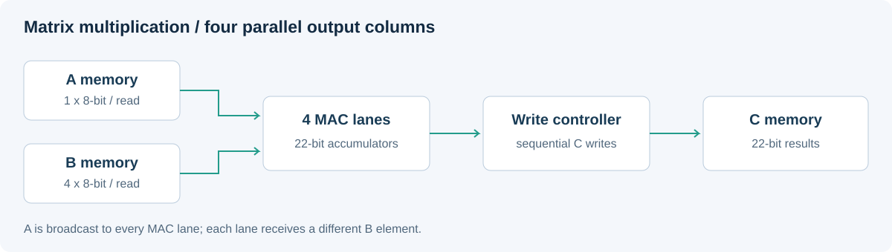

# 64 × 64 행렬곱 제어기

**이현욱 | 고려대학교 전기전자공학부 | VLSI 개인 프로젝트**

[English](README.md) · [RTL](rtl/) · [보고서](reports/course-report.pdf) · [검증·재현 조건](docs/reproducibility.md)

8비트 unsigned 입력 행렬 두 개의 곱을 계산하는 제어기를 Verilog로 구현했습니다. 4개의 MAC이 같은 A 원소와 서로 다른 B 원소를 병렬로 처리하고, 누적 결과를 C 메모리에 순서대로 저장합니다.

## 직접 수행한 내용

- 4개 병렬 MAC과 22비트 누산기를 구성했습니다.
- A·B·C 메모리의 주소 생성과 데이터 배치를 설계했습니다.
- 연산·쓰기 전환, start/reset/done 처리를 구현했습니다.
- SRAM을 제외하고 경계 FF를 둔 합성용 모델을 구성해 타이밍과 면적을 분석했습니다.
- RTL, 시뮬레이션 설정, 합성 결과 분석 및 보고서를 개인 과제로 작성했습니다.

## 보고서에 기록된 결과

| 항목 | 결과 |
| :--- | ---: |
| 행렬 크기 | 64 × 64 |
| 입력 / 누산 비트폭 | 8비트 / 22비트 |
| 타이밍 제약 충족 | **6.3 ns**, 약 158.7 MHz |
| 다음 시험 조건 | 6.2 ns에서 위반 |
| 합성 셀 면적 | 197,099.92 µm² |

수치는 당시 보고서 기준이며, SRAM을 제외한 제어기와 FF-boundary wrapper의 합성 결과입니다. 이번 정리 과정에서 새로 측정한 결과나 실제 칩의 측정값은 아닙니다.

## 파일 구성과 확인 범위

`rtl/`은 제어기, `sim/`은 원본 테스트벤치와 메모리 모델, `synth/`는 합성용 제어기·wrapper, `reports/`는 학번을 제거한 보고서입니다. 제출 RTL을 그대로 보존했습니다.

쓰기 순서를 누산 결과값과 비교해 진행하는 부분은 동일한 결과값이나 0이 반복될 때 추가 검증이 필요합니다. 원본 테스트벤치의 비교 방식도 자동 회귀검증용으로는 보완이 필요합니다. 이러한 범위는 [검증 문서](docs/reproducibility.md)에 명시했습니다.

독립 저장소의 소스 구성은 `tools/compile.py`로 컴파일할 수 있습니다. 원래 사용한 입력·정답 벡터 파일은 포함되어 있지 않습니다.

[DCT 프로젝트](https://github.com/hyvnwook/16x16-2d-dct) · [프로필](https://github.com/hyvnwook) · [연락처](mailto:work.hyunwook@gmail.com)
