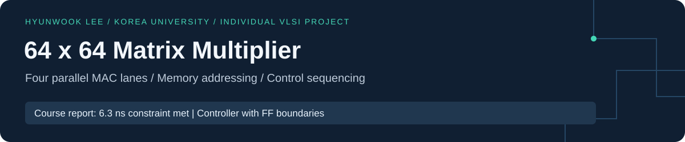
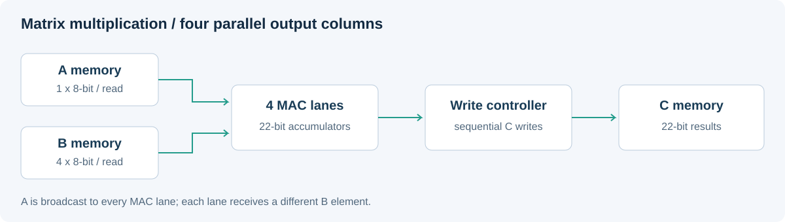

# 64 × 64 Matrix-Multiplication Controller

[Profile](https://github.com/hyvnwook) · [한국어](README.ko.md) · [RTL](rtl/) · [Course report](reports/course-report.pdf)

An individual Verilog project implementing **four parallel multiply-accumulate lanes** and memory-address/control logic for `C = A × B`.

## My contribution

**Hyunwook Lee · Electrical Engineering, Korea University**

This was an individual course project. I wrote the submitted Verilog code and report, including the datapath/control implementation, simulation setup, and synthesis analysis. The archived `.v` files are preserved byte-for-byte. The PDF copy omits my student ID; its technical results are unchanged.

## Architecture



| Property | Implementation |
| :--- | :--- |
| Matrix dimensions | A, B, C: 64 × 64 |
| Inputs | Unsigned 8-bit elements |
| Output/accumulator | 22 bits; up to 64 products per result |
| Parallelism | One A element broadcast to four MAC lanes |
| B memory packing | Four adjacent 8-bit elements in a 32-bit word |
| Result storage | Four accumulated results written sequentially to C memory |
| Control | 16-bit address/progress counter, 2-bit write counter, start/reset/done logic |

I designed the MAC datapath, memory address mapping, read/compute/write transitions, and completion handling, then analyzed the controller's synthesis timing and area.

## Reported synthesis results

| Quantity | Course-report result |
| :--- | ---: |
| Clock constraint met | 6.3 ns, approximately 158.7 MHz |
| Next tested constraint | 6.2 ns, violated |
| Total cell area | 197,099.92 µm² |
| Estimated dynamic power | 18.27 mW |

Sources: course report §3–4. The synthesis target was the controller variant with FF boundaries in `synth/`, **not the complete SRAM-backed system**. The report identifies an input-register → multiplier → accumulator-adder → accumulator-register critical path. These results are not physical implementation or measured silicon results.

## Source guide

| File | Purpose |
| :--- | :--- |
| [`rtl/top_controller.v`](rtl/top_controller.v) | Submitted controller with memory instances |
| [`sim/sti_matmul.v`](sim/sti_matmul.v) | Submitted reference-vector testbench |
| [`sim/models/`](sim/models/) | A, B, and C behavioral memory models |
| [`synth/top_controller_syn.v`](synth/top_controller_syn.v) | Controller variant with external memory-side ports |
| [`synth/top_controller_syn_wrapper.v`](synth/top_controller_syn_wrapper.v) | Registers at controller boundaries for synthesis analysis |

The simulation controller and synthesis variant both define `top_controller`; compile them into separate libraries. The repository helper does this automatically.

## Verification scope and next steps

The report records waveform/reference-output comparisons for the course vectors. Those `vec_a.txt`, `vec_b.txt`, and `vec_c.txt` files are not present in this archive.

The submitted controller is preserved as coursework. Its write-counter transitions compare `mat_C` against accumulator values. **Equal lane results can make data-dependent sequencing ambiguous**, so arbitrary-input correctness is not claimed here. A counter/valid-based write sequencer and directed tests for zero, repeated, maximum-value, and restart cases are the next verification tasks.

The submitted testbench also uses delayed nonblocking assignments for comparison and `!=` rather than an X-sensitive comparison. It should be strengthened before using it as an automated pass/fail regression. See [reproducibility notes](docs/reproducibility.md).

## Compile

With Python 3 and ModelSim/Questa installed, run from this repository root:

```sh
python tools/compile.py --modelsim-bin /path/to/modelsim/bin
```

Simulation and synthesis source sets are compiled into separate libraries under `build/`. This is a compile check, not a synthesis or functional-simulation run. [Check details](docs/compile-check.md).

## Related project

[16x16-2d-dct](https://github.com/hyvnwook/16x16-2d-dct) · [FPGA vector dot product](https://github.com/hyvnwook/8element-vector-multiplier)

Contact: [work.hyunwook@gmail.com](mailto:work.hyunwook@gmail.com)
